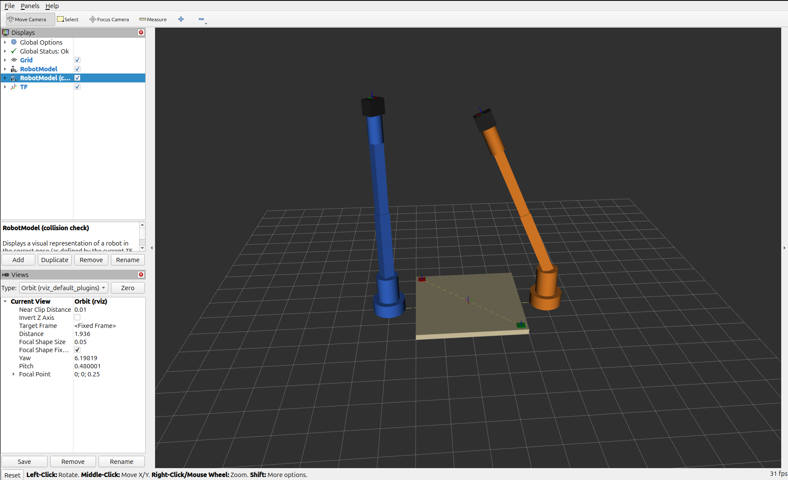
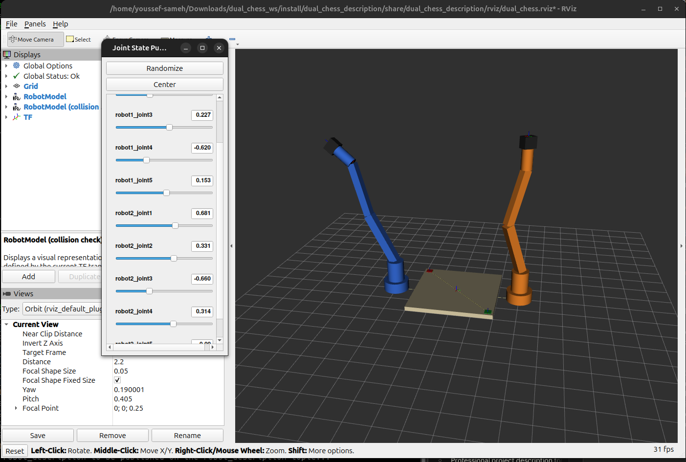
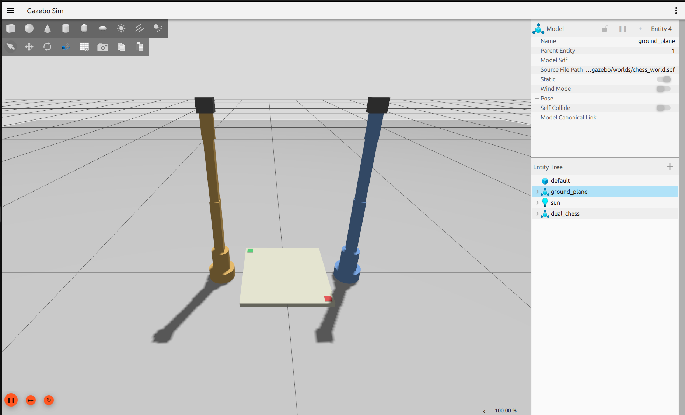

**Status labels used in this report:** **Verified** = executed on the author's local ROS 2 Jazzy machine and supported by the terminal output / RViz screenshot recorded in §15 · **Verified (sandbox)** = executed in a non-ROS sandbox only (Xacro expansion and structure script) · **Verified — placeholder model** = the pipeline works, but it proves only the placeholder arm/board, not the final design · **Not yet verified** = implemented, no evidence yet · *Requires team input* = depends on another member's data.
Facts taken from the project documents are marked **(project)**; my engineering choices are marked **(proposal)**; every number in the model is a **PLACEHOLDER**.

# 1. Introduction
The project builds two identical robotic arms that play chess on one shared board **(project)**. The simulation pipeline defined in the proposal is *CAD → Mesh → URDF/Xacro → ROS 2 → Gazebo → RViz* **(project)**. Week 1 asks for research, then an initial URDF/Xacro structure, Gazebo environment and RViz setup, with a clear next step for Week 2.

# 2. M6 Role
M6 owns URDF/Xacro, Gazebo + RViz, ROS 2 control, testing kinematics/trajectories in simulation. M6 receives geometry from M1 and FK/IK, trajectory and control from M3/M4/M5, and delivers a validated simulation plus robot state and joint commands to M10 **(project, Team Structure)**.

# 3. Week 1 Objectives
Official M6 submission: (1) URDF/Xacro structure, (2) initial Gazebo environment, (3) initial RViz setup, written in the Research / ROS 2 Structure / URDF-Xacro / Gazebo / RViz / Dependencies / Blockers / References format **(project)**. Deliberately *not* done this week: CAD conversion, real inertia, ros2_control, chess pieces (Weeks 2-4) **(project plan)**.

# 4. URDF Research
URDF is an XML description of a robot as a tree of links (rigid bodies with visual, collision, inertial properties) and joints (fixed, revolute, continuous, prismatic…) giving parent/child relation, origin, axis, limits and dynamics. It must be a tree with a single root, unique names and SI units. Each link has a frame; TF is derived from the joint chain. Gazebo requires valid mass/inertia; planners and controllers use limits. For our robot, the URDF will hold links, joints, limits, visual, collision, mass, inertia and frames per arm **(project, Proposal §12)**. DOF and geometry are not yet specified, so a generic 5-revolute-joint arm is used **(placeholder)**. Details: `docs/01_research.md` §A.

# 5. Xacro Research
Xacro adds properties, math, macros, arguments, conditionals and includes to URDF. Using it avoids duplicating two full arm descriptions and lets M1/M3 data be changed in one file. Decision **(proposal)**: one reusable `chess_arm` macro with a `prefix` parameter and an `*origin` block, instantiated twice (`robot1_`, `robot2_`); placeholders isolated in `arm_params_placeholder.xacro`; launch-time arguments `robot1_enabled`, `robot2_enabled`, `sim_gazebo`, `use_meshes`. Details: §B of the research file.

# 6. Gazebo Research
Gazebo Harmonic (gz-sim 8) with `ros_gz` is the Gazebo/ROS pairing with binary packages for ROS 2 Jazzy per the `ros_gz` repository **(proposal)**; the simulation was run locally through the Jazzy `ros_gz` packages (local installation: Gazebo Sim 8.15.0, i.e. Harmonic, from `gz sim --version`). It provides physics, collision, joints, sensors, plugins and worlds. The proposal uses Gazebo for physics, joint movement, collision detection, motion testing, chess-piece manipulation and two-robot interaction **(project, Proposal §13)**. Week 1 needs only world + physics + spawning + basic joint hold; controllers, pieces and collision tests are later (table in research §C).

# 7. RViz Research
RViz 2 visualises ROS data: RobotModel (from `/robot_description`), TF, Fixed Frame, Grid, and sensor displays; joint motion is driven by `/joint_states`. Proposal uses RViz for TF visualization, robot model visualization, coordinate-frame debugging, sensor visualization and ROS 2 debugging **(project)**. Initial config: Fixed Frame `world`, Grid, RobotModel, collision RobotModel (off), TF.

# 8. ROS 2 Package Structure
*Implemented (files written).* Workspace `dual_chess_ws/src` with `dual_chess_description`, `dual_chess_gazebo`, `dual_chess_bringup` (all `ament_cmake`). Future: `dual_chess_control` (M6+M5, Week 3); interfaces/kinematics/vision/chess packages belong to M10/M3/M7/M8. **Names must be aligned with M10, who creates the project's ROS 2 package structure in Week 1 (project)** — *Requires team input.* Tree and per-package table: `docs/02_architecture.md`.

```
dual_chess_ws/src/
├── dual_chess_description/ {package.xml, CMakeLists.txt, urdf/, rviz/, launch/, meshes/, scripts/}
├── dual_chess_gazebo/      {package.xml, CMakeLists.txt, worlds/, config/, launch/}
└── dual_chess_bringup/     {package.xml, CMakeLists.txt, launch/}
```

# 9. Initial URDF/Xacro Architecture
*Implemented.* One combined description `dual_chess` with root `world`: `board_link → board_surface → board_a1 / board_h8`, and two arms mounted on `world`. Each arm: `base_link → joint1 (Z) → link1 → joint2 (Y) → link2 → joint3 (Y) → link3 → joint4 (Y) → link4 → joint5 (Z) → link5 → gripper_link → tcp_link`.
- **PLACEHOLDER:** 5 revolute joints, axes, link sizes, joint limits (|q| up to 2.8 rad on joint 1, narrower elsewhere), effort 10 N·m, velocity 1 rad/s, masses, primitive inertia, gripper box, TCP at gripper tip. *All require M1/M3/M4/M2 data.*
- Mirroring: Robot 2 is a 180° rotated copy at the opposite side; the proposal says "mirrored coordinate frames" — *Requires team input* (M1/M3).
- Meshes: folder layout and `use_meshes:=true` switch prepared; STL/DAE from M1 replace primitives with no change to the macro structure.
- Two-robot separation: every link/joint carries its prefix (`robot1_*`, `robot2_*`), so no names collide (`robot1_joint1` vs `robot2_joint1`, `robot1_base_link` vs `robot2_base_link`). Namespaces apply to the command topics (`/robot1/...`, `/robot2/...`); `/joint_states` and TF are shared on purpose (one `robot_state_publisher`, one TF tree).
- Evidence: Xacro expansion for 6 argument combinations and a structure checker (unique names, single root, connected, limits) ran in a non-ROS sandbox (**Verified (sandbox)**): both robots → 21 links / 20 joints / 10 revolute. The default and Gazebo variants were also processed locally by `robot_state_publisher` during launch, and the local TF tree contains exactly the expected frames (§15). `check_urdf` (urdfdom) also parses the expanded URDF successfully (§15, Appendix A).

# 10. Initial Gazebo Environment
*Implemented; Verified locally (placeholder model) — see §15.* `chess_world.sdf`: DART physics (1 ms step), gravity, sun, 10×10 m ground plane. Board and both robots come from the URDF and are spawned by `gazebo.launch.py` (`ros_gz_sim create`), keeping one source of truth for placement. `ros_gz_bridge` carries `/clock`, `/joint_states` and `/robotN/jointM/cmd_pos`. Chess pieces and ros2_control are Week 3.

**Scope of the joint control (important):** the per-joint hold/command mechanism (gz `JointPositionController` in `use_velocity_commands` mode, speed-limited to the placeholder `arm_velocity_limit`) is a **temporary, simulation-level Week 1 stand-in** whose only purpose is to keep the arms upright and let the pipeline be exercised. It is **not** the project's control architecture. The final ROS 2 control / PID / stepper-motor architecture belongs to later integration (M5 control design, M9 electronics, M6 ros2_control + `gz_ros2_control`, Week 3 onward) and will replace these plugins.

# 11. Initial RViz Setup
*Implemented; Verified locally via `display.launch.py` and `simulation.launch.py` — see §15.* `rviz/dual_chess.rviz` (Fixed Frame `world`, Grid, RobotModel, collision RobotModel disabled by default, TF) is loaded by both `display.launch.py` (robot_state_publisher + joint_state_publisher_gui + rviz2, for RViz-only work) and `simulation.launch.py` (RViz driven by Gazebo joint states). The screenshot shows blue Robot 1 and orange Robot 2 on opposite sides of the board, the a1 (red) and h8 (green) markers, TF axes, Global Status OK. The RViz-only launch `display.launch.py` was also run locally: the joint_state_publisher_gui sliders move each `robot1_`/`robot2_` joint (Figure 2).

# 12. Dependencies
Week 1 proceeds with clearly marked placeholders, so none of the items below stops the Week 1 deliverables. They are inputs M6 will consume when other members' work arrives.

**Coordination needed now (Week 1)**

| From | Needed | Why |
|---|---|---|
| M10 | ROS 2 package structure/names, topic/service/action list | M10 owns the package skeleton; M6's three package names and the command topics should match it |

**Expected from other members' Week 1 outputs (to be integrated in Week 2; placeholders in place)**

| From | Needed | Replaces |
|---|---|---|
| M1 | DOF/joint configuration, initial link dimensions + base size | 5-DOF placeholder arm, link sizes (`arm_params_placeholder.xacro`, joint list in `arm.macro.xacro`) |
| M3 | Coordinate frames (joint axes, TCP, board↔robot transform, mirror convention) | joint axes, TCP, board frame convention, Robot 2 placement |
| M4 | Initial joint limits | placeholder limits |
| M2 | Board square size/thickness, gripper concept/dimensions | board and gripper placeholders |

**Required later (by design, not Week 1 blockers)**

| From | Needed | When |
|---|---|---|
| M1 | Final CAD meshes (STL/DAE, metres, link-frame origin, collision meshes) and mass properties | Week 2 |
| M4 / M9 | Velocity/torque limits, motor torque/speed, workspace/base distance | Week 2 |
| M5 | Control architecture (PID structure, stepper interface) for ros2_control | Week 2-3 |
| M2 | Chess-piece dimensions | Week 3 |
| M7 | Camera placement (optional simulated camera) | Week 3+ |
| M8 | Board-state / square naming convention | Week 3 |

# 13. Blockers
**No blocker prevents the Week 1 M6 deliverables.** Open coordination items:
1. **Package naming/structure with M10** (M10 owns the package skeleton) — to be agreed; renaming my three packages is cheap if needed.
2. **Inputs from M1/M2/M3/M4** (§12) — currently placeholders. Becomes a blocker for Week 2 only if these are not delivered in time.
3. **Mirrored-frame convention** (rotated copy vs reflected geometry) — decision for M1/M3.
4. **Controller/interface type for the stepper actuators (project)** — M5, needed before the Week 3 ros2_control work; not needed for Week 1.

# 14. Initial Implementation
Files delivered: three ROS 2 packages (description, gazebo, bringup), 8 Xacro files, world SDF, bridge YAML, RViz config, three launch files, structure-check script, README with commands, verification and troubleshooting guides. See README and `docs/`.

# 15. Verification
Environment: local ROS 2 Jazzy machine of the author. Evidence = terminal output and RViz screenshot captured during local execution of `ros2 launch dual_chess_bringup simulation.launch.py` and follow-up commands.

| Item | Status | Evidence |
|---|---|---|
| Workspace builds and launches from the install space | **Verified** | `simulation.launch.py` started gazebo, robot_state_publisher, ros_gz_bridge and rviz2; `robot_state_publisher: Robot initialized` |
| Xacro processed with both robots + Gazebo plugins (`sim_gazebo:=true`) | **Verified** | same launch log (xacro runs inside the launch file) |
| Xacro expansion for all argument variants; structure check (unique names, one root, connected, limits; 21 links / 20 joints / 10 revolute) | **Verified (sandbox)** | non-ROS sandbox, xacro 2.1.1 |
| Gazebo world launches, model spawns, physics runs | **Verified — placeholder model** | log: `Entity creation successful`; `/joint_states` streams 13 entries (10 revolute `robot1_joint1..5`, `robot2_joint1..5` + 3 fixed) at sim time 41 s; positions stay 0 (arms hold). First run showed frame errors caused by `board_link` lacking an `<inertial>`; fixed in `board.macro.xacro`, after which the model streams joint states and responds to commands |
| Joint command path (temporary controller, §10) | **Verified — placeholder model** | `/robot1/joint1/cmd_pos` 0.6 → `robot1_joint1` = 0.6; `/robot2/joint2/cmd_pos` 0.4 → `robot2_joint2` = 0.4000024; uncommanded joints ≈ 0 (`robot1_joint5` ≈ 0, robot2 joint3/4 < 2e-6) |
| Two-robot separation (prefixes, command namespaces, no name collisions) | **Verified** | joint names above; commanding Robot 2 did not move Robot 1; TF frames below |
| TF tree | **Verified** | `view_frames`: 20 frames below `world` — `board_link → board_surface → board_a1/board_h8`, `robot1_base_link … robot1_tcp_link`, `robot2_base_link … robot2_tcp_link`; single tree |
| RViz (via `simulation.launch.py`) | **Verified** | screenshot (Figure 1): both arms + board, a1/h8 markers, TF display, Global Status OK, pose follows Gazebo joint states |
| RViz-only launch `display.launch.py` (joint sliders) | **Verified** | screenshot (Figure 2): RViz + joint_state_publisher_gui with sliders for `robot1_`/`robot2_` joints, arms posed by the sliders, Global Status OK |
| `check_urdf` (urdfdom parser) | **Verified** | `Successfully Parsed XML`; root `world` with 3 children (`board_link`, `robot1_base_link`, `robot2_base_link`); full chains to each `tcp_link` (Appendix A) |
| Gazebo GUI: ground, board, both arms, entity tree | **Verified — placeholder model** | screenshot (Figure 3): `ground_plane`, `sun`, `dual_chess` in the entity tree, board with a1/h8 markers, both arms; `gz model --list` → `ground_plane`, `dual_chess`; Gazebo Sim 8.15.0 (Appendix A) |
| `use_meshes:=true` | Not testable until M1 meshes exist (switch prepared) | — |

**Limitation of all verification above:** it proves the software pipeline (Xacro → TF → RViz → Gazebo → bridge) using the *placeholder* 5-DOF arm, placeholder board/layout and temporary joint controller. It does not validate any final mechanical, kinematic or control design; that depends on M1/M2/M3/M4/M5/M9 (§12).

# 16. Next Steps
1. Agree package names/interfaces with M10; confirm board frame and mirroring with M3.
2. Receive M1 DOF/dimensions → edit `arm_params_placeholder.xacro` and the joint list in `arm.macro.xacro`.
3. Week 2: import M1 meshes, CAD mass/inertia, collision meshes, M4 limits; verify both robots in Gazebo + RViz.
4. Week 3: replace hold plugins with ros2_control (with M5), add board squares and pieces.

# 17. References
1. ROS 2 Jazzy documentation — https://docs.ros.org/en/jazzy/
2. ROS 2 Jazzy tutorials: URDF — https://docs.ros.org/en/jazzy/Tutorials/URDF/URDF-Main.html
3. ROS 2 Jazzy: "Using Xacro to Clean Up a URDF File" — https://docs.ros.org/en/jazzy/Tutorials/URDF/Using-Xacro-to-Clean-Up-a-URDF-File.html
4. URDF XML specification — http://wiki.ros.org/urdf/XML
5. Xacro documentation — http://wiki.ros.org/xacro  ·  source: https://github.com/ros/xacro
6. Gazebo Sim 8 (Harmonic) API reference, Joint Controllers (JointController, JointPositionController, JointStatePublisher) — https://gazebosim.org/api/sim/8/jointcontrollers.html ; JointPositionController (`use_velocity_commands`, `cmd_max`) — https://gazebosim.org/api/sim/8/classgz_1_1sim_1_1systems_1_1JointPositionController.html
7. `ros_gz` (ROS 2 ↔ Gazebo packages; Jazzy/Harmonic pairing table) — https://github.com/gazebosim/ros_gz ; `ros_gz_bridge` (Jazzy) — https://docs.ros.org/en/jazzy/p/ros_gz_bridge/
8. SDFormat specification — http://sdformat.org/spec
9. RViz User Guide (Jazzy) — https://docs.ros.org/en/jazzy/Tutorials/Intermediate/RViz/RViz-User-Guide/RViz-User-Guide.html
10. tf2 tutorials (Jazzy) — https://docs.ros.org/en/jazzy/Tutorials/Intermediate/Tf2/Tf2-Main.html
11. REP 103 (units/conventions) — https://www.ros.org/reps/rep-0103.html · REP 105 (frames) — https://www.ros.org/reps/rep-0105.html
12. ros2_control (Jazzy) — https://control.ros.org/jazzy/index.html · `gz_ros2_control`: https://github.com/ros-controls/gz_ros2_control
13. Project documents: Week 1 Tasks; Chess Robot Team Structure & 5-Week Plan; Dual Robotic Arm Autonomous Chess System Project Proposal.

# Appendix A — Evidence

**Figure 1 — RViz driven by Gazebo (`simulation.launch.py`), arms posed by commands to `/robot1/joint1/cmd_pos` and `/robot2/joint2/cmd_pos`.**



**Figure 2 — RViz-only launch (`display.launch.py`) with joint_state_publisher_gui sliders.**



**Figure 3 — Gazebo Sim (Harmonic) with `chess_world.sdf`: ground plane, sun, board and both arms (`dual_chess`).**



**`check_urdf` output (expanded `dual_chess.urdf.xacro`, local):**

```
robot name is: dual_chess
---------- Successfully Parsed XML ---------------
root Link: world has 3 child(ren)
    child(1):  board_link
        child(1):  board_surface
            child(1):  board_a1
            child(2):  board_h8
    child(2):  robot1_base_link
        child(1):  robot1_link1 -> link2 -> link3 -> link4 -> link5 -> robot1_gripper_link -> robot1_tcp_link
    child(3):  robot2_base_link
        child(1):  robot2_link1 -> link2 -> link3 -> link4 -> link5 -> robot2_gripper_link -> robot2_tcp_link
```
(chains abbreviated; the full tree printed by `check_urdf` lists each link as a nested child.)

**Gazebo (local):** `gz model --list` → `ground_plane`, `dual_chess` (world `chess_world`); `gz sim --version` → Gazebo Sim, version 8.15.0.

**TF (local):** `ros2 run tf2_tools view_frames` — one tree rooted at `world`; 20 frames: `board_link`, `board_surface`, `board_a1`, `board_h8`, and `robotN_base_link`, `robotN_link1..5`, `robotN_gripper_link`, `robotN_tcp_link` for N = 1, 2. (Generated PDF: `frames_2026-10-06_00.01.13.pdf`.)
